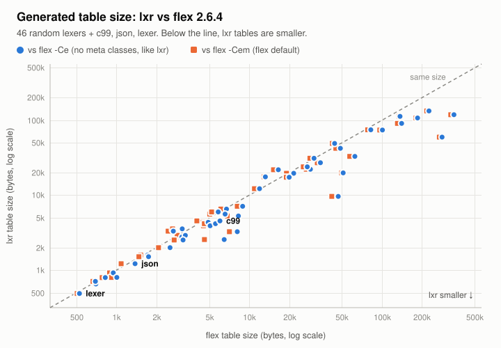

# Overview
 
  Interested in developing lexers ( read source code token by token ) ?
  Here is a minimal effort.

  The script can be used to create lexer source file like unix lex/
  GNU [flex](https://github.com/westes/flex) (note : flex is no more
  an official GNU package). For portability, it accepts flex's grammar
  file with few exceptions in the patterns.
  The main [API](https://github.com/basilkottilingal/lexer/blob/main/src/lxr/api.c)
  function are

```c
void lxr_source     ( const char * source );
void lxr_read_bytes ( const char * bytes, size_t len, int bol );
int  lxr_input      ( );
int  lxr_unput      ( );
void lxr_token      ( );
void lxr_clean      ( );
```
  In case lexer function's signature **YY_DECL** is not provided by the user,
  the default lexer function will look like
```c
int lxr_lex (void)
```

  **v2.0** fixes 20+ generator bugs, including mis-tokenizing scanners from
  v1.0 (regenerate your lexers). See the [CHANGELOG](CHANGELOG.md) and the
  [comparison with flex](#comparison-with-flex).

# Tokenizer or Lexer reader

  Creates a lexer generator header from a lexer grammar file. 
  The grammar file format is the same as `Flex`'s input file format.

  Convert a lexer grammar file to lexer source file as follows, given
  `make` and c99 supporting `gcc` or `clang` compiler are installed.

```bash
git clone git@github.com:basilkottilingal/lexer.git
cd lexer
make lxr
./lxr -o c99.c c99.lex
```

  (fixme : export to bashrc. Might need LXRPATH also!!)

## Input file
  Input file format is the same as specified by flex
```
definitions
%%
rules
%%
user code
```
  There are few exceptions
  1. flex options will be ignored
  2. The OR operator as in the following cases are not-implemented
```lex
%%
"foo" |
"bar" { /*foo or bar : action */ }
%%
```
  Instead you can use single line OR operato, where action falls in the same
  line as the pattern and there are no unwanted white spaces
```lex
%%
"foo"|"bar" { /*foo or bar : action */ }
%%
```

### Regex

  1. Support most of POSIX ERE symbols in the lexer grammar.
  2. Following regular expression are implemented

| Symbol   | Name         | Meaning / Description                                                   |
| -------- | ------------ | ----------------------------------------------------------------------- |
| `.`      | Dot  | Matches **any single character** except newline (`\n`)                          |
| `^`      | Beginning anchor | Matches the **start of a line**                                     |
| `$`      | End anchor   | Matches the **end of a line**                                           |
| `[...]`  | Character class  | Matches **any one character** in the set                            |
| `[^...]` | Negated character class  | Matches **any one character not** in the set                |
| `\|`     | Alternation  | Matches **either of the pattern** before o after `\|` in the current group |
| `()`     | Grouping     | Groups expressions as a single unit, affects alternation and repetition |
| `*`      | Zero or more | Matches **zero or more** repetitions of the preceding expression        |
| `+`      | One or more  | Matches **one or more** repetitions of the preceding expression         |
| `?`      | Zero or one  | Matches **zero or one** occurrence of the preceding expression          |
| `{n}`    | Exact repetition | Matches **exactly n** occurrences of the preceding expression       |
| `{n,}`   | Lower-bounded repetition | Matches **n or more** occurrences                           | 
| `{,m}`   | Upper-bounded repetition | Matches **atmost m** occurrences                            | 
| `{n,m}`  | Bounded repetition   | Matches **between n and m** occurrences (inclusive)             |
| `\`      | Escape | Removes special meaning from the next character (e.g., `\.` matches a literal `.`) |

  3. Additionally uses quotes (ex : `"foo"`) for string matching as in flex
  4. NOTE : DOESN'T support any kind of pattern lookahead assertions.
```lex
foo/bar    { /* foo is followed by bar */ }
foo(?=bar) { /* foo is followed by bar */ } 
foo(?!bar) { /* foo is not followed by bar */ } 
```
  So it's upto user to handle these look ahead patterns by appropriate alternative methods
  like using appropriate context sensitive parser, or implementing a lookahead
  using `lxr_input()` and/or `lxr_unput()`

  5. NOTE : DOESN'T support EOF as in flex
```lex
<<EOF>>    { /* flex allows EOF action, but not allowed in this code */ }
```

## Comparison with flex

  Size of the generated tables, lxr vs [flex](https://github.com/westes/flex)
  2.6.4, for the grammars in `languages/` and for 46 random lexers (5 to 39
  rules each). Both scanners were also run on random input; they produced
  the same tokens in every case shown.

<picture>
  <source media="(prefers-color-scheme: dark)" srcset="docs/img/flex-comparison-dark.svg">
  
</picture>

| Lexer | lxr | flex `-Ce` | lxr / flex `-Ce` | flex `-Cem` (default) | lxr / flex `-Cem` |
|---|---:|---:|---:|---:|---:|
| `languages/c99/c99.lex`   | 4544 B | 6018 B | 0.76 | 4031 B | 1.13 |
| `languages/json/json.lex` | 1218 B | 1380 B | 0.88 | 1084 B | 1.12 |
| `languages/test/lexer.lex` | 488 B | 526 B | 0.93 | 506 B | 0.96 |
| 46 random lexers (geometric mean)      | | | **0.76** | | **0.84** |
| &emsp;flex `-Ce` tables < 5 kB (15)    | | | 0.92 | | 1.03 |
| &emsp;5 – 50 kB (21)                   | | | 0.78 | | 0.88 |
| &emsp;> 50 kB (10)                     | | | 0.53 | | 0.56 |

  lxr tables are smaller than flex `-Ce` (equivalence classes, no meta
  classes, the same setup as lxr) for 37 of 46 random lexers. Against
  flex's default `-Cem`, which adds meta equivalence classes, lxr is smaller
  for 28 of 46. It wins on the large lexers and loses slightly on small ones
  like `c99.lex` and `json.lex`. lxr has no meta classes yet: it emits a
  `lxr_meta[]` table but doesn't use it, so the table is not counted above.

  Sizes count every table in bytes, using the C element type in the
  generated code: lxr `check next base accept def class`; flex `yy_accept
  yy_ec yy_meta yy_base yy_def yy_nxt yy_chk`. To reproduce, or try other
  seeds, flex modes or sizes, see [test/comparison](test/comparison/README.md):

```bash
cd test/comparison
make N=100 SEED=1     # writes out/report.md, out/results.csv
make plot             # regenerates docs/img/flex-comparison-*.svg
```

## Regex pattern matching using NFA.

  The same script can be used to look if a text satisfies regex pattern
```c
  #include "regex.h"
  #include <stdio.h>

  int main () {
    char rgx[] = "(a|b)*c";
    char str[] = "aac";
    int len = rgx_nfa_match (rgx, str); // returns > 0, if successfull
    if (len) {
      char holdchar = str [len-1];
      str [len-1] = '\0';
      printf ("substring \"%s\" matched pattern \"%s\"", str, rgx);
      str [len-1] = holdchar;
    }
  }
```

## References, Read More

  1. regular expression (regex) are converted to NFA using [Thompson's NFA 
construction](https://dl.acm.org/doi/abs/10.1145/363347.363387). Minimal
implementation in C is [here](https://swtch.com/~rsc/regexp/regexp1.html)
  2. NFA to DFA conversion and minimisation of DFA transition Table using [Hopcroft's
algorithm](https://www.sciencedirect.com/science/article/abs/pii/B9780124177505500221)
```
Hopcroft, J. E.
“An n log n algorithm for minimizing states in a finite automaton.”
Theory of Machines and Computations, Academic Press, 1971, pp. 189–196.
```
  3. Equivalence classes
  4. Table-Based Lexers (DFA Execution Models)
```
Aho, A. V., Sethi, R., and Ullman, J. D.
Compilers: Principles, Techniques, and Tools (1st ed., 1986) — “The Dragon Book”.
```
  5. Table compression Techniques
```
Aho, Alfred V., and Ullman, Jeffrey D.
“Compressed Representation of Finite Automata.”
Proceedings of the 3rd Annual ACM Symposium on Theory of Computing (STOC), 1971, pp. 116–123.
```

## ToDo

  1. OR operator ('|') for multiple patterns with same action (as in flex)
  2. garbage collection : deallocate () in case memory is constrained
  3. Hopcroft minimisation needs optimisation : it is very slow for large
     DFAs (see below)
  4. Tables are written as `short`, so a lexer is limited to 32767 table
     entries. flex switches to 32-bit tables for large DFAs; lxr could do
     the same.

### Hopcroft minimisation is slow

  It is fine for typical lexers (`c99.lex`: 0.01 s), but very slow for large
  DFAs, where it takes nearly all of lxr's run time. Times to generate the
  lexer, for the slowest cases of `test/comparison` (seed 1):

| Case | DFA states (flex) | flex | lxr |
|---|---:|---:|---:|
| `rand_s1_088` | 1388   | 0.04 s | 1.3 s |
| `rand_s1_023` | 2526   | 0.09 s | 2.2 s |
| `rand_s1_054` | 1932   | 0.06 s | 2.3 s |
| `rand_s1_064` | 5881   | 0.26 s | 30 s ¹ |
| `rand_s1_051` | 6797   | 0.33 s | 39 s ¹ |
| `rand_s1_040` | 14060  | 1.8 s  | 226 s ¹ |
| `rand_s1_080` | ?      | > 2 min ² | > 2 min ² |

  ¹ lxr then stops with *Out of table size limit 32767* (ToDo 4).
  ² stopped after 2 min; flex is slow on this one too.

  To get a case: `cd test/comparison && make N=100 SEED=1`; the lexer is
  `out/cases/<case>.l`.

  Where the time goes (sampled with gdb on `rand_s1_040`): every sample was
  in `hopcroft ()`, in two loops in `src/dfa.c`:

  - for each splitter `A` and each class `c`, *all* states are scanned to
    find the predecessors `{ q : δ(q,c) ∈ A }`;
  - every block `Y` of the partition is intersected with `X` as a full bit
    set, even though `X` touches only a few blocks.

  That is roughly O(|W| · nclass · n²/64), where `n` is the number of states
  and `|W|` the number of splitters processed. The fix is the standard
  O(m · n log n) implementation: inverse transition lists per class, a block
  id per state, splitting only the blocks that `X` touches, and a
  block-in-W flag instead of comparing bit sets with every entry of W.
